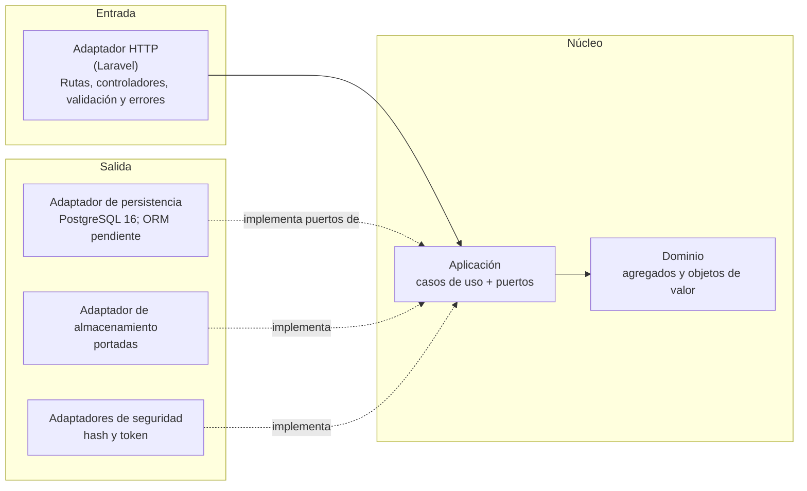
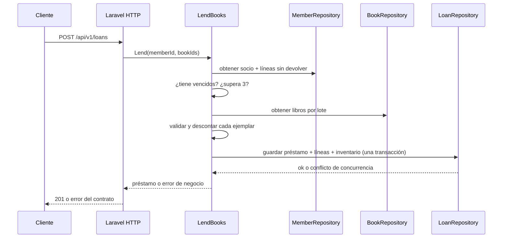

# Arquitectura — Manager Library (PHP/Laravel)

Arquitectura **hexagonal** (puertos y adaptadores), compartida con las referencias. Laravel implementa la entrada HTTP y el arranque del backend. Los límites entre dominio, aplicación y adaptadores son normativos; los nombres de carpetas de abajo son una organización propuesta para facilitar la traducción.

## 1. Capas y dependencias



Las dependencias apuntan hacia adentro. Laravel y sus adaptadores no aparecen en las reglas del dominio ni en los puertos de aplicación. Un único punto de composición conecta los puertos con los adaptadores.

## 2. Organización propuesta

La estructura exacta se puede ajustar para respetar la organización de Laravel, siempre que conserve los límites de la constitución.

```text
app/
├── Domain/                  # Book, Loan, LoanItem, Member, User; Isbn, Quantity, DateRange
├── Application/
│   ├── Ports/Outbound/       # BookRepository, LoanRepository, MemberRepository, UserRepository,
│   │                         # ReportReader, Clock, PasswordHasher, TokenIssuer, CoverStorage
│   └── UseCases/             # LendBooks, ReturnItem, CreateBook, SearchBooks, Overdue,
│                             # MostBorrowedReport, Login, CreateLibrarian
├── Http/                     # Entrada Laravel: controladores, requests y manejo de errores
└── Infrastructure/
    ├── Persistence/          # Adaptadores de repositorio y migraciones propiedad de api
    ├── Storage/              # Portadas
    └── Security/             # Hash y token
```

El registro de dependencias se centraliza en el arranque/composición del backend. La ubicación Laravel concreta y el ORM no están fijados en las fuentes y deben confirmarse antes de hacerlos obligatorios.

## 3. Agregados

| Raíz | Contiene | Invariantes que defiende |
|---|---|---|
| `Book` | `Isbn`, copias totales y disponibles, baja lógica | disponibles entre 0 y total; total ≥ 1; título no vacío |
| `Loan` | colección de `LoanItem` | 1 a 3 líneas; sin libro repetido; vencimiento a 14 días; inmutable salvo devolución |
| `Member` | nombre y documento | documento obligatorio y único |
| `User` | nombre, rol y hash | nombre normalizado; rol en (`admin`, `librarian`) |

`Loan.AddItem` valida y prepara la línea junto con el descuento del ejemplar. Guardar el préstamo, sus líneas y el nuevo inventario es una sola transacción. `Loan.ReturnItem` permite devolver cada línea una sola vez y restituye exactamente un ejemplar.

## 4. Flujo: registrar un préstamo



## 5. Errores

El dominio y la aplicación usan errores de negocio propios (`BookNotAvailable`, `MemberHasOverdue`, `MemberLimitExceeded`, entre otros). El adaptador HTTP de Laravel los traduce al código y cuerpo únicos definidos en [`api-contract.md`](api-contract.md). Los errores internos del framework no se exponen al cliente.

## 6. Qué no hay

Sin eventos, colas, caché, microservicios ni multi-tenencia. Se añaden solo si un requisito aprobado los pide.
