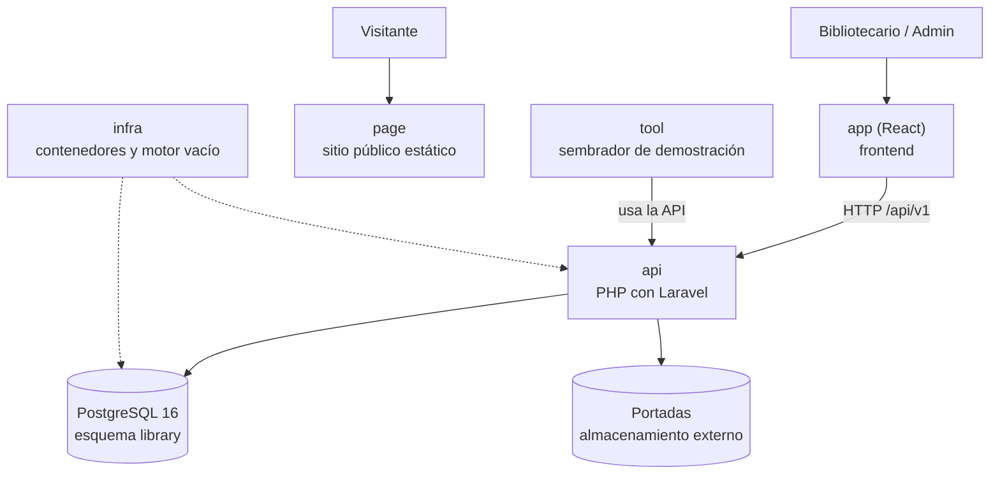

# Arquitectura en una página — Manager Library (PHP/Laravel)

Resumen para leer antes del detalle de [`architecture.md`](architecture.md). PHP/Laravel y React son el stack del reto; los contratos funcionales permanecen en [`spec.md`](spec.md), [`api-contract.md`](api-contract.md) y [`data-model.md`](data-model.md).

## El sistema en una imagen

## Los seis repositorios y su papel

| Repo | Papel | Evidencia principal |
|---|---|---|
| `docs` | Especificaciones y contratos | Se puede construir desde los documentos sin inventar reglas |
| `api` | Reglas de negocio y contrato HTTP en PHP/Laravel | Pruebas de dominio, aplicación, contrato y concurrencia |
| `app` | Pantallas de operación en React | Recorrido: login → prestar → devolver → reporte |
| `page` | Presentación pública estática, sin llamadas a la API | Funciona en móvil y escritorio |
| `infra` | Contenedores, red, volúmenes y motor vacío | Arranque documentado en un comando |
| `tool` | Datos de demostración mediante la API | La lista de vencidos y el reporte devuelven datos sembrados |

## Las cinco ideas que sostienen el diseño

1. **El préstamo es un hecho:** solo se modifica `returned_at` de una línea al devolverla.
2. **El inventario y el préstamo cambian juntos:** registrar o devolver una línea y ajustar existencias forman una operación transaccional.
3. **El estado se calcula:** `open`, `overdue` y `closed` no se guardan como columna.
4. **Lo congelado no sigue al catálogo:** renombrar un libro no altera los reportes históricos.
5. **La base protege los datos:** restricciones, claves e índices expresables en PostgreSQL se declaran en el esquema de `api`.

La traducción PHP/Laravel conserva estas reglas. El ORM, el hash de contraseña, la librería JWT y las herramientas de pruebas siguen pendientes en [`plan.md`](plan.md).
